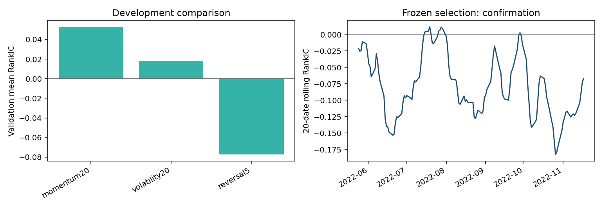
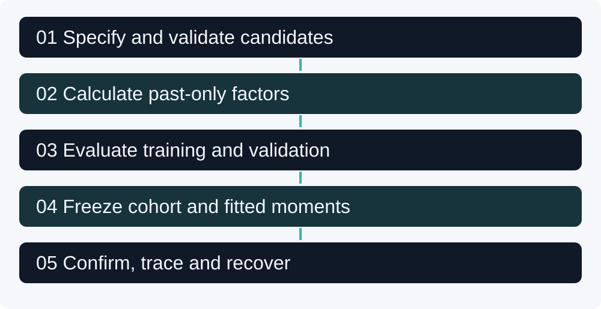

[](https://github.com/Mingju-Zhang-CBS/agentic-quant-research/actions/workflows/checks.yml)

[Research Studio](https://github.com/Mingju-Zhang-CBS) · [Research map](https://github.com/Mingju-Zhang-CBS/Quant)

# Agentic Quant Research

**Question:** Can a research workflow preserve the distinction between a valid idea, a development winner and an unsuccessful confirmation result?

I implemented a small offline controller connecting candidate specifications, safe expression evaluation, date-aware research, frozen selection, evidence and sealed-stage recovery. It is inspired by the public research-automation problem addressed by [Microsoft RD-Agent](https://github.com/microsoft/RD-Agent), with an independently written implementation and synthetic inputs.

The word *agentic* describes the workflow boundary being studied. The default proposer is a six-item JSON fixture: no language model is called. Human-authored or externally generated proposals enter through the same validator. Full Qlib integration and live model generation are future extensions, not claims about this demo.

## Read the recorded result first

- Input: **15,120 synthetic rows, 20 assets and 756 supplied sessions**.
- Technical outcomes: **3 admitted, 1 duplicate, 2 rejected**.
- Retained partition dates: **433 training / 141 validation / 147 confirmation**, after five-session label-end purging.
- Development selects **momentum20**. Its confirmation mean RankIC is **-0.0707**, with a moving-block date-bootstrap interval **[-0.1219, -0.0304]**.

**Research judgment:** the selected hypothesis fails in confirmation in this synthetic run. I retain the result and the frozen sign/selection. The demonstrated contribution is an inspectable process that can reject a hypothesis, not discovered market alpha. A small positive validation statistic did not justify a success claim.



## Skills demonstrated

| Capability | Inspectable evidence |
| --- | --- |
| Research engineering | Distinct technical admission, development, freeze and confirmation stages. |
| Financial data contracts | Balanced keyed OHLCV panel, finite values, OHLC bounds and no hidden fill. |
| Validation design | Whole-date partitions, five-session target-end purging and training-only fitted moments. |
| Safe proposal handling | JSON operator whitelist, bounded windows, explicit failure reasons and canonical duplicates. |
| Statistical judgment | Per-date RankIC, training-only sign choice, validation selection and block-bootstrap uncertainty. |
| Reproducibility | Input/source fingerprints, immutable artifacts, sequenced lineage and sealed-stage resumes. |

## Complete workflow



1. Validate the input panel and proposal shape before calculation.
2. Reject unavailable fields and future references; keep rejected and duplicate rows visible.
3. Calculate three past/current-only factors on the common panel and form separate five-session labels.
4. Partition dates; remove labels that cross a later evaluation boundary.
5. Fit moments and factor direction on training only; compare the fixed candidates on validation.
6. Freeze the complete cohort, fitted transformations and winner before confirmation.
7. Report the outcome and its limitations with enough artifacts to inspect selection and recover a sealed stage.

There is no unrestricted generated-code execution or automated order placement. The expression language supports lag, return, negate and rolling standard deviation, not arbitrary Python. A syntactically valid expression still needs an economic hypothesis and empirical evaluation.

## Reproduce the study

Use **Python 3.12** and an isolated environment:

```text
python -m venv .venv
```

Activate with `.venv\Scripts\Activate.ps1` on Windows PowerShell or `source .venv/bin/activate` on macOS/Linux. Then:

```text
python -m pip install -r requirements.lock.txt
python -m pip install --no-deps -e .
python -m pytest
python -m agentic_quant_research --demo --output local-runs/demo
```

After installing dependencies, the demonstration runs offline without a GPU, company account, model endpoint or paid API. Use a new or empty output directory. Saved examples in `reports/demo/` contain the recorded run; `local-runs/` and `private-data/` are ignored.

### Demonstrate checkpoint recovery

```text
python -m agentic_quant_research --demo --output local-runs/recovery --stop-after frozen
python -m agentic_quant_research --demo --output local-runs/recovery --resume
```

The frozen stage has no confirmation metrics. A later identical completed resume returns saved metrics without adding another lineage event. Changed inputs, proposals, source or tracked artifacts fail closed. Mid-stage crashes can require a fresh output directory; this is not a distributed job system.

### Bring independently obtained inputs

```text
python -m agentic_quant_research --market-csv private-data/market.csv --proposals examples/proposals.json --output local-runs/user-study
```

The CSV requires exactly `date,asset,open,high,low,close,volume`; the JSON format is demonstrated in the supplied fixture. Use your own lawful input and keep user-data outputs outside the public release. Calendar order must be meaningful: an anonymous group ID is not an exchange date.

## Engineering map and checks

[`core.py`](agentic_quant_research/core.py) contains validation, expression evaluation, split construction, IC statistics, frozen selection and the artifact lifecycle. [`__main__.py`](agentic_quant_research/__main__.py) handles CLI modes. [`test_workflow.py`](tests/test_workflow.py) checks contracts, future perturbations, label-end dates, training moments, confirmation isolation, resumes and accidental tampering.

[`examples/explain_workflow.py`](examples/explain_workflow.py) builds a small panel and traces admission and partition counts. The [walkthrough](docs/WALKTHROUGH.md) explains the full-run split arithmetic, a standardized factor and the negative confirmation result. Artifact hashes detect inconsistencies; they are not an independent guarantee against an actor who rewrites every local file.

## Limits and next questions

Synthetic dynamics, one seed and a three-factor search do not establish a financial edge. IC does not specify holdings, turnover, costs or executable P&L. Ten-date resampling blocks retain some local dependence but cannot account for arbitrary long-memory behavior or an entire research history. Future work should compare lawful real-data tasks and actual model-generation policies under a separately frozen evaluation budget.

## Reading guide

- [Methods and contracts](docs/METHODS.md): precise inputs, conventions and limits.
- [Worked walkthrough](docs/WALKTHROUGH.md): follow a numerical example and the implementation.
- [Executed report](reports/demo/REPORT.md): inspect the complete recorded experiment.
- [Interview discussion](docs/INTERVIEW.md): decisions, failure modes and questions to defend.
- [Resume evidence](docs/RESUME.md): claims traceable to generated artifacts.
- [Provenance](docs/PROVENANCE.md): authorship boundaries, public references and data rights.

Development and documentation were AI-assisted. The new implementation is a public-method demonstration prepared for Mingju Zhang. Original academic, employer and recruitment files are outside the distribution. The [MIT license](LICENSE) applies to newly authored code; dependency and external-data rights remain separate.
