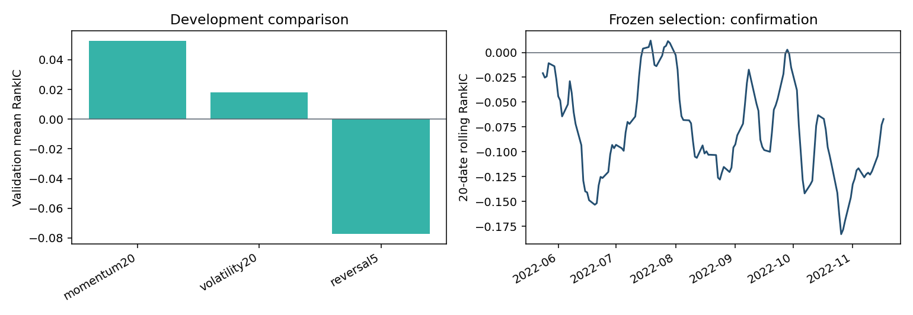

# Agentic Quant Research

Can an offline research controller preserve the difference between a technically valid factor, a development selection and its confirmation result? This synthetic demonstration follows candidate proposals through validation, date-aware evaluation, frozen selection and checkpoint recovery.

**Finding.** On **15,120 synthetic rows** (20 assets over 756 sessions), three of six fixture proposals are admitted, one is a duplicate and two are rejected. The development-selected `momentum20` has confirmation mean RankIC of **−0.0707**, with a moving-block 95% interval of **[−0.1219, −0.0304]**. The workflow preserves the frozen factor and sign when confirmation is unfavorable.

[Run report](reports/demo/REPORT.md) · [Methods](docs/METHODS.md) · [Run the demo](#run-the-demo)



*Synthetic panel and fixed JSON proposals. RankIC measures cross-sectional rank association. The report records training and validation selection, confirmation results and their dependence-aware intervals.*

## Workflow and recovery

1. Validate the balanced OHLCV input and parse proposals through an allowlisted expression language. Record admission, canonical duplicates and rejections.
2. Build five-session labels and purge dates whose label ends cross a partition boundary. Fit moments and factor direction on training. Compare admitted candidates on validation.
3. Freeze the cohort, fitted transforms and selection before confirmation. Use fingerprints and sequenced lineage to verify artifacts when resuming a sealed stage.

The default proposer is a JSON fixture. The demo runs offline without a language model or Qlib. The generated data and one fixture run support a workflow demonstration. RankIC alone does not establish turnover, costs or executable returns. [Walkthrough](docs/WALKTHROUGH.md) · [Proposal examples](examples/proposals.json) · [Workflow tests](tests/test_workflow.py)

## Run the demo

Use Python 3.12 from the repository root. Activate the virtual environment with `.venv\Scripts\Activate.ps1` in PowerShell or `source .venv/bin/activate` on macOS/Linux.

```bash
python -m venv .venv
# Activate the environment before installing.
python -m pip install -r requirements.lock.txt
python -m pip install --no-deps -e .
python -m pip check
python -m pytest -q tests
python -m agentic_quant_research --demo --output local-runs/demo
```

Use a fresh output directory. To inspect recovery, stop after selection and resume with the same inputs and directory:

```bash
python -m agentic_quant_research --demo --output local-runs/recovery --stop-after frozen
python -m agentic_quant_research --demo --output local-runs/recovery --resume
```

The frozen checkpoint precedes confirmation metrics. The [methods](docs/METHODS.md) document resume checks, the external market CSV contract and artifact limits. [Implementation](agentic_quant_research/core.py) · [Technical discussion](docs/DISCUSSION.md)

The independently implemented controller draws on public research automation ideas, including [Microsoft RD-Agent](https://github.com/microsoft/RD-Agent). The [provenance](docs/PROVENANCE.md) records research direction, AI assistance and dependencies. [MIT license](LICENSE) · [Research directory](https://github.com/Mingju-Zhang-CBS/Quant)
